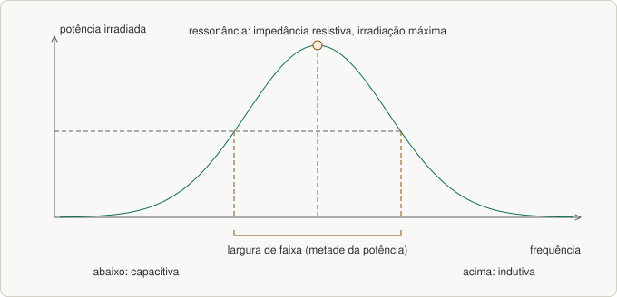
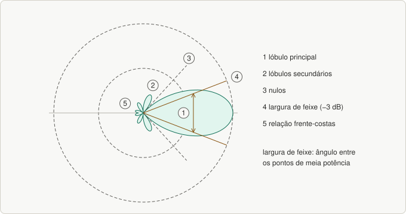

# Aula 02 — Antenas: conceitos básicos

> Base: *Wi-Fi · aula 4 – Antenas, conceitos básicos*. Lista: [`listas/lista-02.md`](../listas/lista-02.md)

## 1. O que uma antena faz

A antena **converte** corrente elétrica em onda eletromagnética (transmissão) e onda em corrente (recepção). Analogia: o alto-falante converte sinal elétrico em som; a antena converte sinal elétrico em "sinal no ar".

**Campo próximo × campo distante:** nem todo campo gerado pela antena vira onda que se propaga. Parte induz de novo tensão e corrente na própria antena (por causa da indutância e da capacitância distribuídas no condutor); esse é o **campo próximo**, que **decai rapidamente** com a distância.

## 2. Circuitos equivalentes, ressonância e largura de faixa

- A impedância da antena tem componente **indutiva** e **capacitiva**. Na **frequência de ressonância** ela é **puramente resistiva** e a **irradiação é máxima**.
- Acima da ressonância a antena fica **indutiva**; abaixo, **capacitiva**. Nos dois casos **cai a potência** irradiada.
- A potência máxima também depende do **casamento de impedância** com a linha de alimentação.
- **Largura de faixa de operação:** faixa de frequências em que a antena irradia **metade da potência máxima**. Conforme a relação, a antena é de **faixa estreita** ou **faixa larga**.
- **Antena receptora:** modelada por uma **fonte** (tensão nos terminais em aberto) e a **impedância interna**.
- **Reciprocidade:** tudo o que vale para a antena transmitindo **vale também recebendo**.

*Figura 17.1: Ressonância e largura de faixa.*

## 3. Alimentação da antena

A forma de alimentar influencia quase todas as outras características. O ponto-chave é o **melhor casamento possível** entre antena e linha. Quando não dá, usam-se dispositivos como o **toco de linha**.

| Faixa | Estrutura de alimentação | Observação |
|---|---|---|
| VHF inferior | linhas bifilares | impedância de 300 a 600 Ω |
| VHF superior até UHF superior (2 GHz) | cabos coaxiais | precisam de **baluns** |
| SHF | guia de onda | usa alimentadores |

**Balun** (*balanced to unbalanced*) liga uma linha balanceada a uma desbalanceada, como um adaptador de tomada. Três tipos comuns:

1. **Com transformador:** transformador simples + capacitor; sintonizado na frequência; usado até ~**100 MHz**.
2. **Casador de λ/4 (bazuca):** liga o condutor externo do coaxial a um tubo condutor, a λ/4 da antena.
3. **Dobrado de λ/2:** a diferença de percurso de λ/2 coloca as correntes em **oposição de fase**, formando linha balanceada.

A impedância da antena depende principalmente das **características construtivas** e da **forma de alimentação**.

## 4. Diagrama de irradiação (resposta de uma questão da lista)

- **Antena isotrópica:** hipotética, irradia **igualmente em todas as direções** (a lâmpada nua que ilumina tudo).
- Na prática a energia se concentra em **direções preferenciais** (a lanterna).
- **Diagrama de irradiação:** representação gráfica, normalmente em dois planos, **horizontal** e **vertical**.
- **Lóbulo:** parte entre dois **nulos**. O maior é o **principal**; os demais, **secundários**.
- O diagrama **não muda a forma da frente de onda**: só concentra mais potência em certas regiões.

**O que se lê no diagrama:** lóbulo principal e **direção do máximo**, **largura de feixe**, lóbulos secundários, **nulos** e **relação frente-costas**.

*Figura 17.2: Diagrama de irradiação e o que se lê nele.*

### Largura de feixe
Mede a capacidade de **concentrar a energia** em torno da direção do máximo. É o **ângulo entre os pontos do lóbulo principal com metade da potência (−3 dB)**. Não confundir com **largura de faixa**, que é sobre **frequência**.

### Relação frente-costas
Razão entre a potência irradiada no feixe de −3 dB do lóbulo principal e a região oposta ao máximo.

## 5. Polarização

A **polarização da onda** é a **direção do campo elétrico**. A da antena é a direção do campo elétrico no **máximo do diagrama**, e **muda com a orientação da antena**. Para boa recepção, as antenas transmissora e receptora devem ter **polarizações compatíveis**.

Tipos *(complemento)*: **linear** (vertical ou horizontal), **circular** (direita ou esquerda) e **elíptica**.

## 6. Qual antena é a mais usada em Wi-Fi? *(complemento)*

A **omnidirecional** (dipolo, ganho de ~2 a 5 dBi): cobre **360° no plano horizontal** sem precisar apontar, é **barata**, e os clientes são **móveis** e espalhados. Antenas **direcionais** (painel, Yagi, parabólica) servem a enlaces ponto a ponto.

---

## Exercícios

Lista: [`listas/lista-02.md`](../listas/lista-02.md) — respostas: [`respostas/lista-02.md`](../respostas/lista-02.md)

---

## Resumo

- Antena: converte corrente ↔ onda; **reciprocidade**.
- **Ressonância:** impedância resistiva = irradiação máxima; **largura de faixa** = metade da potência.
- **Balun:** liga linha balanceada a desbalanceada (3 tipos).
- **Diagrama de irradiação:** lóbulos, nulos, **largura de feixe (−3 dB)**, frente-costas.
- **Polarização:** direção do campo elétrico; antenas devem ser compatíveis.
- Wi-Fi: **omnidirecional** é a mais comum.
