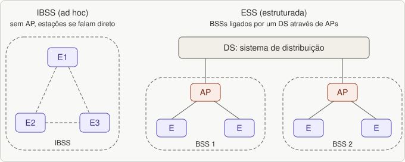
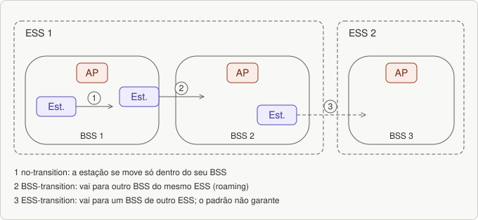

# Aula 05 — A rede WLAN: topologias e camada física do 802.11

> Base: *Wi-Fi · aula 9 (parte inicial)*. Lista: [`listas/lista-05.md`](../listas/lista-05.md)

## 1. Topologias da WLAN

Uma **WLAN** (rede local sem fio) deve dar **mobilidade às estações, de forma transparente** para os protocolos de nível mais alto. O 802.11 suporta duas topologias:

| Topologia | O que é |
|---|---|
| **IBSS** (*Independent Basic Service Set*) | rede **sem backbone de infraestrutura**, com **pelo menos duas estações**; é a rede **ad hoc** |
| **ESS** (*Extended Service Set*) | rede **com backbone de infraestrutura**, que liga estações sem fio e rede cabeada; é a rede **estruturada** (de infraestrutura) |

**Ad hoc × estruturada (pergunta da lista):** em uma ad hoc as estações **conversam diretamente**, **sem AP**, em geral de forma temporária. Na estruturada elas conversam **por meio de um AP**, que dá acesso ao sistema de distribuição e à rede cabeada.

*Figura 20.1: IBSS (ad hoc) × ESS (infraestrutura).*

### Os componentes da rede estruturada

Analogia: pense num **prédio com várias salas** ligadas por corredores.

| Sigla | Nome | Em palavras simples |
|---|---|---|
| **BSA** | Basic Service Area | a **célula**: a área de cobertura (depende do ambiente e da potência dos transmissores) |
| **BSS** | Basic Service Set | o **grupo de estações** que se comunicam numa BSA (a "sala") |
| **AP** | Access Point | estação especial que **captura transmissões para outras BSAs** e as retransmite pelo sistema de distribuição; também faz a **ponte** entre a rede sem fio e a rede física |
| **DS** | Distribution System | infraestrutura que **interliga várias BSAs** (os corredores) |
| **ESA** | Extended Service Area | a **interligação de várias BSAs** pelos APs via DS |
| **ESS** | Extended Service Set | **conjunto formado por vários BSSs** ligados por um DS |

### Mobilidade

| Tipo | Significa |
|---|---|
| **No-transition** | a estação se move **só dentro da sua BSS** |
| **BSS-transition** | migra de um BSS para **outro dentro do mesmo ESS** (roaming) |
| **ESS-transition** | migra para um BSS de **um ESS diferente**; **não é garantida pelo padrão** |

*Figura 20.2: Mobilidade: no-transition, BSS-transition e ESS-transition.*

## 2. Camada física do 802.11 original e das primeiras extensões

| Camada física | Características |
|---|---|
| **Infravermelho** | transmissão **difusa**; **1 e 2 Mbps**; **não atravessa paredes**; baixa banda |
| **FHSS** | **79 canais de 1 MHz** no início da banda ISM de 2,4 GHz; saltos por números **pseudoaleatórios**; **tempo de parada < 400 ms**; boa resistência a multipercurso e interferência; baixa banda |
| **DSSS** | semelhante ao **CDMA**; cada bit vira **11 chips**; usa **PSK**; baixa banda |
| **OFDM** (802.11a) | até **54 Mbps** na banda de **5 GHz**; **52 frequências: 48 para dados e 4 para sincronização**; **PSK até 18 Mbps** e **QAM até 54 Mbps**; melhor imunidade a interferência estreita; compatível com o europeu HiperLAN/2 |
| **HR-DSSS** (802.11b) | **11 milhões de chips/s**; **1, 2, 5,5 e 11 Mbps** em **2,4 GHz**; 1 e 2 Mbps com PSK (compatibilidade); 5,5 e 11 Mbps com **códigos de Walsh/Hadamard**; taxa **adaptada dinamicamente**; **mais lento que o 802.11a**, mas com alcance **cerca de 7 vezes maior** |
| **802.11g** (nov/2001) | usa a modulação **OFDM do 802.11a**, mas em **2,4 GHz**, junto com o 802.11b; até **54 Mbps** |

Observe: o **802.11b não é continuação do 802.11a**; são caminhos diferentes (DSSS em 2,4 GHz × OFDM em 5 GHz). O **802.11g** une o melhor dos dois.

---

## Exercícios

Lista: [`listas/lista-05.md`](../listas/lista-05.md) — respostas: [`respostas/lista-05.md`](../respostas/lista-05.md)

---

## Resumo

- **IBSS** = ad hoc, sem infraestrutura; **ESS** = vários **BSS** ligados por um **DS** através de **APs**.
- Mobilidade: **no-transition**, **BSS-transition**, **ESS-transition** (esta não garantida).
- PHY: **IR**, **FHSS** (79 canais), **DSSS** (11 chips), **OFDM/11a** (5 GHz, 48+4 subportadoras), **HR-DSSS/11b** (11 Mbps), **11g** (OFDM em 2,4 GHz).
