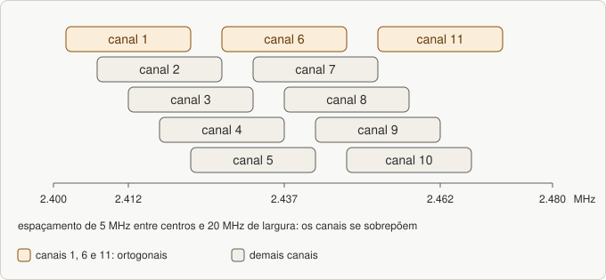
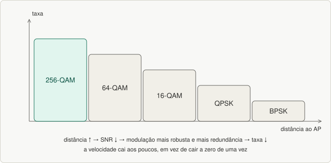
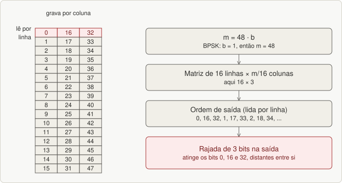

# Aula 06 — Canalização, SNR/BER e MCS

> Base: *Wi-Fi · aula 10 – Canalização* (a mesma apresentação trata de canais, MCS e interleaving). Lista: [`listas/lista-06.md`](../listas/lista-06.md)

## 1. Canalização do Wi-Fi

| | 2,4 GHz | 5 GHz |
|---|---|---|
| Faixa (slide) | **2.400 a 2.483,5 MHz** | **5.150 a 5.350 MHz** |
| Largura do canal | **20 MHz ou 40 MHz** | **20, 40, 80 ou 160 MHz** |
| Canais | total de **11** (padrão americano) | **8 canais ortogonais** |
| Observação | **espaçamento de 5 MHz entre canais causa superposição**; **1, 6 e 11 são ortogonais (não interferentes)** | muito mais espaço, portanto mais canais sem sobreposição |

Analogia: a faixa é uma **avenida** e cada canal é uma **faixa de carro**. Em 2,4 GHz os carros são tão largos (20 MHz) para o espaçamento (5 MHz) que **só cabem 3 sem se esbarrar**: os canais 1, 6 e 11.

> **Nota:** o Brasil permite os canais 1 a 13 em 2,4 GHz *(complemento)*, mas os canais **ortogonais continuam sendo 1, 6 e 11**. Na prova, use os números do slide. Frequência central: 2,4 GHz = 2407 + 5·n MHz; 5 GHz = 5000 + 5·n MHz *(complemento)*.


*Figura 21.1: Canais de 2,4 GHz: só 1, 6 e 11 não se sobrepõem.*

## 2. SNR, BER e alcance (perguntas da lista)

- **SNR (relação sinal-ruído)** = potência do sinal ÷ potência do ruído; em dB, **SNR = 10·log₁₀(Ps/Pn)**. Mede a **qualidade do enlace**.
  - No DSSS, o ruído inclui **interferências e os demais canais espalhados**.
- **BER (taxa de erro de bit)** = bits recebidos com erro ÷ bits transmitidos.
- **Relação:** quanto **maior a SNR, menor a BER** *(complemento)*, e o efeito depende da modulação.
- **BER × perda × alcance:**

```
distância ↑  → perda de transmissão ↑  → sinal recebido ↓ → SNR ↓
            → BER ↑ → retransmissões ↑ e taxa ↓ → limite do ALCANCE útil
```

Por que a SNR importa: ela determina **qual modulação é possível** (aula 03) e, portanto, a **taxa**. O slide diz que **a distância e a SNR são determinantes na escolha do MCS**.

## 3. MCS — Modulation and Coding Scheme

- **MCS** avalia a **qualidade do ambiente de RF** (que aparece nas transmissões). **Cada dispositivo, AP ou cliente, decide internamente** o MCS que usará.
- O MCS **resume e categoriza** parâmetros: **modulação, codificação, intervalo de guarda, número de streams e largura do canal**.
- **Quanto maior o MCS, melhor o desempenho, mas mais estrito o requisito de SNR.**
- **Armadilha de desempenho:** dispositivos com **MCS baixo** ocupam o ar por **muito tempo (ToA ou *airtime*)**, o que **prejudica todos os outros** dispositivos do mesmo AP. Um cliente longe e lento atrasa a rede inteira.

### Modulação e codificação adaptativa (pergunta da lista)

O rádio **mede a qualidade do enlace** (SNR, erros, perdas de ACK) e escolhe o **MCS**:

- sinal **bom** → modulação alta e pouca redundância → **taxa máxima**;
- sinal **ruim** → modulação robusta e **mais redundância (codificação)** → taxa menor, mas **sem perder o enlace**.

É por isso que a velocidade do Wi-Fi **cai aos poucos** ao se afastar do roteador, em vez de cair a zero de uma vez.


*Figura 21.2: Adaptação de modulação: a taxa cai aos poucos com a distância.*

## 4. Interleaving (entrelaçamento)

- Faz parte da **codificação**. A intenção é melhorar a capacidade do receptor de **corrigir rajadas de erros**, **espalhando-as** em bits distantes entre si.
- No 802.11 há **duas rodadas** de entrelaçamento:
  1. a sequência do codificador convolucional é dividida em **grupos de mesmo tamanho** *m*; com **b** bits por subportadora (BPSC, bits por ponto da constelação), **m = 48·b**;
  2. **1ª rodada:** os *m* bits entram numa **matriz de 16 linhas e m/16 colunas**, **gravados por coluna e lidos por linha** (exemplo BPSK: m = 48 → 16 × 3);
  3. **2ª rodada:** um **deslocamento cíclico** em cada metade de ponto da constelação: **0 ou 1** para 16-QAM, **0, 1 ou 2** para 64-QAM, conforme o índice da subportadora.

Analogia: embaralhar as cartas antes de distribuí-las: se uma "rajada" apagar 3 cartas seguidas, depois de reorganizar elas ficam **separadas**, e dá para corrigir cada uma.


*Figura 21.3: Entrelaçamento: bits consecutivos na saída vêm de posições distantes.*

---

## Exercícios

Lista: [`listas/lista-06.md`](../listas/lista-06.md) — respostas: [`respostas/lista-06.md`](../respostas/lista-06.md)

---

## Resumo

- 2,4 GHz: 2.400–2.483,5 MHz, canais de 20/40 MHz, **1, 6 e 11 ortogonais**. 5 GHz: 5.150–5.350 MHz, 20/40/80/160 MHz, **8 canais ortogonais**.
- **SNR ↑ → BER ↓**; distância ↑ → SNR ↓ → BER ↑ → alcance limitado.
- **MCS** = modulação + codificação + guarda + streams + largura; **cada dispositivo escolhe**; MCS baixo consome *airtime*.
- **Interleaving:** m = 48·b; matriz 16 × m/16; deslocamento cíclico.
