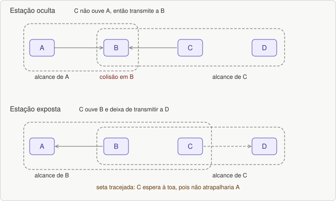
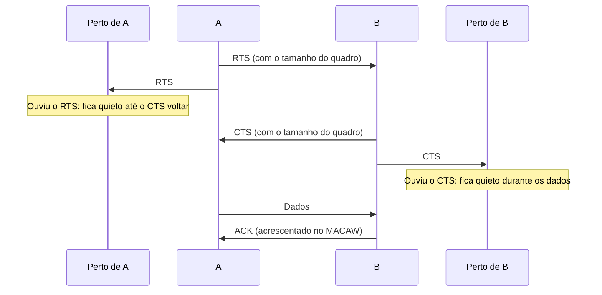
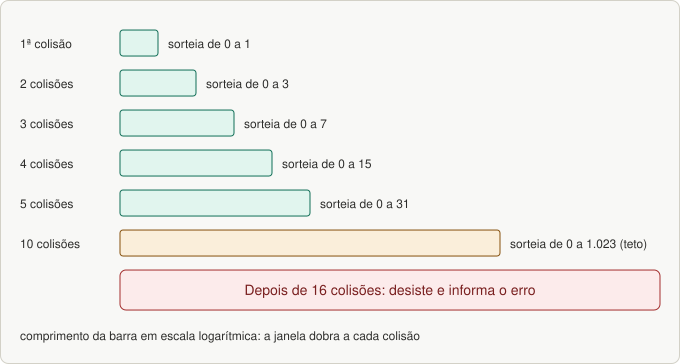

# Aula 07 — Acesso ao meio no Wi-Fi: CSMA/CA, MACA, DCF e PCF

> Base: *Wi-Fi · aula 8 – Camada de enlace* e *aula 9 (subcamada MAC)*. Lista: [`listas/lista-07.md`](../listas/lista-07.md)

## 1. O problema: o rádio não escuta enquanto fala

No Wi-Fi o meio é o ar, e nem toda estação ouve todas as outras. Isso causa dois problemas clássicos (use as estações A, B, C, D em linha):

```
A ─── B ─── C ─── D        (A só alcança B; B alcança A e C; C alcança B e D)
```

### Estação oculta (escondida)
A transmite para B. C quer transmitir para B, **escuta o canal e não ouve ninguém** (A está fora do seu alcance), então transmite: **colisão em B**. Uma estação **não consegue detectar a concorrência** porque o concorrente está **longe demais**.

### Estação exposta
B está transmitindo para A. C quer transmitir para D, **ouve B** e **não transmite**, embora **não atrapalhasse** A. Capacidade desperdiçada.


*Figura 22.1: Estação oculta e estação exposta.*

## 2. MACA e MACAW

**MACA** (*Multiple Access with Collision Avoidance*, protocolo antigo):

1. O transmissor envia um quadro curto, o **RTS** (*Request to Send*), com o **tamanho** do quadro que vai mandar.
2. Se o receptor aceita, responde com o **CTS** (*Clear to Send*), também com esse tamanho.
3. Quem **ouve o RTS** está perto de A e **fica quieto** o tempo do CTS voltar. Quem **ouve o CTS** está perto de B e **fica quieto durante a transmissão** dos dados.
4. **Ainda pode haver colisão** (B e C mandam RTS ao mesmo tempo). Quem não recebe CTS no tempo esperado **espera um tempo aleatório** (**recuo binário exponencial**).


*Figura 22.2: troca RTS/CTS do MACA e quem fica quieto.*

**Recuo binário exponencial:** após a 1ª colisão, 0 ou 1 slot; após a 2ª, 0 a 3; em geral, após *i* colisões sorteia-se de **0 a 2^i − 1**. Depois de **10** colisões o teto fica em **1023 slots**; depois de **16**, o controlador desiste e informa o erro.


*Figura 22.3: Recuo binário exponencial: a janela dobra a cada colisão.*

**MACAW** (MACA para *wireless*) acrescenta: **ACK após cada quadro**; uso de **CSMA** (para não mandar RTS enquanto outra estação transmite); **recuo individual por fluxo** (origem → destino); **troca de informação sobre congestionamento**.

## 3. As duas funções de coordenação do 802.11

| | **DCF** | **PCF** |
|---|---|---|
| Nome | *Distributed Coordination Function* | *Point Coordination Function* |
| Controle | **sem controle central** | a **estação base controla** toda a atividade da célula |
| Método | **CSMA/CA** (disputa) | **polling** (consulta) |
| Rede típica | ad hoc | estruturada |
| Obrigatório? | **sim** (toda implementação aceita) | **opcional** |

## 4. CSMA/CA (DCF)

Usa **detecção de canal físico e de canal virtual**. Dois métodos:

**1º método (escuta física):**

1. A estação **escuta** o canal antes de transmitir; se **ocioso**, transmite.
2. **Durante a transmissão o canal não é escutado**, e o quadro pode ser destruído no receptor por interferência.
3. Se **ocupado**, adia até o canal ficar inativo. Se houver colisão, espera **tempo aleatório** (recuo binário exponencial).

**2º método (canal virtual, baseado no MACAW):** usa **RTS/CTS** e o **NAV**.

- **NAV** (*Network Allocation Vector*): **não é transmitido**; é só um **lembrete interno** de que a estação deve **ficar inativa por certo tempo** (o tempo vem do campo **Duração**, aula 08).

Por que "evitar" colisão e não "detectar"? Porque o rádio **não escuta enquanto transmite** e há estações ocultas.

## 5. Fragmentação

- O 802.11 permite **dividir quadros em partes menores** para lidar com **canais ruidosos**.
- Cada fragmento tem **seu próprio total de verificação**, é **numerado** e é **confirmado** (protocolo *stop-and-wait*).
- Vários fragmentos podem sair em **rajada**: aumenta a **vazão**, porque as **retransmissões ficam restritas aos fragmentos defeituosos**.
- O tamanho do fragmento **não é fixado pelo padrão**. O NAV mantém as outras estações quietas **até a próxima confirmação**.

**Como é o envio?** fragmento 1 → ACK (após **SIFS**) → fragmento 2 → ACK... Como só se espera um SIFS, a estação **mantém o canal** durante a rajada.

## 6. Polling (PCF)

- Usado em **redes estruturadas**. A **estação base pergunta às outras** se têm quadros a enviar; **a ordem é totalmente controlada por ela**. O padrão **não especifica** frequência, ordem ou se todas devem receber atendimento idêntico.
- A estação base **difunde periodicamente um quadro de baliza (beacon)**, de **10 a 100 vezes por segundo**, com parâmetros do sistema (sequência de saltos e tempos de parada para o FHSS, **sincronização do relógio** etc.).
- **PCF e DCF podem coexistir numa mesma célula**, definindo **intervalos de tempo entre quadros** (IFS, aula 08): depois de um quadro, é exigido um tempo de inatividade antes de qualquer estação enviar outro.

## 7. Pratique

```bash
cd praticas
node backoff.js 5      # faixa de sorteio e colisões médias por número de estações
```

---

## Exercícios

Lista: [`listas/lista-07.md`](../listas/lista-07.md) — respostas: [`respostas/lista-07.md`](../respostas/lista-07.md)

---

## Resumo

- **Oculta:** não ouve o concorrente → colisão. **Exposta:** ouve quem não atrapalha → fica calada à toa.
- **MACA:** RTS/CTS; **MACAW:** + ACK, CSMA, recuo por fluxo.
- **Recuo:** 0 a 2^i − 1 (teto 1023 após 10; desiste após 16).
- **DCF** (CSMA/CA, obrigatório) × **PCF** (polling, opcional); **coexistem**.
- **NAV:** lembrete interno do canal virtual. **Fragmentação:** rajada de fragmentos com ACK após SIFS.
