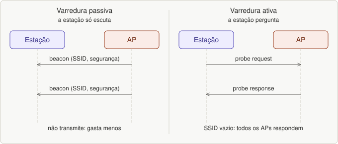
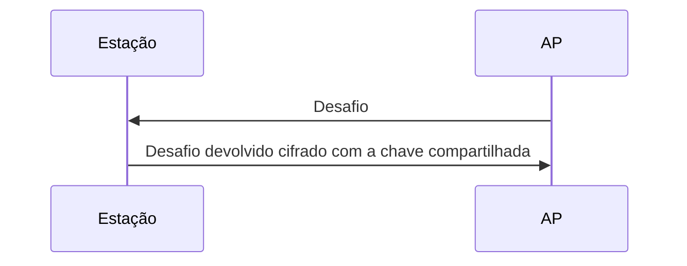

# Aula 09 — Beacon, varredura, autenticação e associação

> Base: *Wi-Fi · aula 7 – Associação*. Lista: [`listas/lista-09.md`](../listas/lista-09.md)

## 1. A visão geral

**Associação** é o processo de **ligar uma estação à rede por meio de um ponto de acesso**. São quatro passos, nesta ordem:

```
1. Varredura  →  2. Escolher o AP  →  3. Identificar-se (autenticação)  →  4. Associar-se
```

Analogia: **entrar numa festa**: procurar a casa certa (varredura), escolher qual, mostrar o convite (autenticação) e ser anotado na lista de convidados (associação).

## 2. O beacon (quadro de baliza)

**Beacon** é um quadro **enviado periodicamente pelos APs** (ou pelas estações, em redes ad hoc) para **avisar de sua presença** e passar as informações de que uma estação precisa para se associar: o **nome da rede (SSID)** e o **método de segurança**, entre outras.

**Por que é necessário?**

- permite a **descoberta** da rede (varredura passiva);
- traz parâmetros do sistema e a **sincronização do relógio**;
- no PCF, é a **referência do superquadro** (10 a 100 vezes por segundo);
- no modo de economia de energia, serve de **período de escuta** (aula 10).

## 3. Varredura

Procurar os APs disponíveis chama-se **varredura**, porque a estação **muda de canal** para descobrir pontos de acesso em **todos os canais** da faixa do 802.11.

| | **Passiva** | **Ativa** |
|---|---|---|
| O que a estação faz | apenas **escuta** os beacons dos APs | **envia um *probe request*** para ver se há redes por perto |
| O que recebe | beacons (com SSID e demais dados) | **probe response** de cada AP compatível, com campos parecidos aos do beacon |
| Detalhe | tenta associar-se ao BSS com o SSID e as informações encontradas | o *probe request* costuma conter o **SSID desejado**; se estiver **vazio, todos os APs que ouvirem respondem** |
| Uso | descoberta geral, **gasta menos e não transmite** | **buscar uma rede conhecida**, mais rápida |


*Figura 24.1: Varredura passiva × ativa.*

## 4. Autenticação

Exige que a estação **estabeleça sua identidade com o AP**. O padrão define dois tipos:

- **Sistema aberto:** **sem chave compartilhada ou senha**.
- **Chave compartilhada:** com uma **chave compartilhada (senha)**, usando criptografia simétrica e um mecanismo de **desafio e resposta**: uma das partes (normalmente o AP) envia um **desafio** e a outra o **devolve cifrado** com a chave compartilhada.


*Figura 24.2: autenticação por chave compartilhada, com desafio e resposta.*

## 5. Associação

- Concluída a autenticação, a estação envia um quadro ***association request*** ao AP e passa a ter acesso à rede.
- **Ocorre só em redes de infraestrutura**, **não** em ad hoc.
- Uma estação móvel só pode estar associada a **um único BSS por vez**.
- O AP **cria uma entrada** para a estação e envia uma **mensagem ARP na rede cabeada** com o **MAC** dela, **registrando-a nos switches**.
- Em seguida o AP devolve um identificador, o **AID**, num quadro ***association response***.

```
Estação                       AP
  │── probe request ────────►│
  │◄──────── probe response ─│       (varredura ativa)
  │── autenticação ─────────►│
  │◄───────── autenticação ──│
  │── association request ──►│
  │◄── association response ─│   (traz o AID)
```

---

## Exercícios

Lista: [`listas/lista-09.md`](../listas/lista-09.md) — respostas: [`respostas/lista-09.md`](../respostas/lista-09.md)

---

## Resumo

- Associação = **varredura → escolher AP → autenticar → associar**.
- **Beacon:** quadro periódico com SSID e segurança; base da varredura passiva e da sincronização.
- **Passiva** (escuta beacons) × **ativa** (probe request / probe response).
- Autenticação: **sistema aberto** × **chave compartilhada** (desafio e resposta).
- Associação: só em infraestrutura; recebe o **AID**; o AP avisa os switches por **ARP**.
