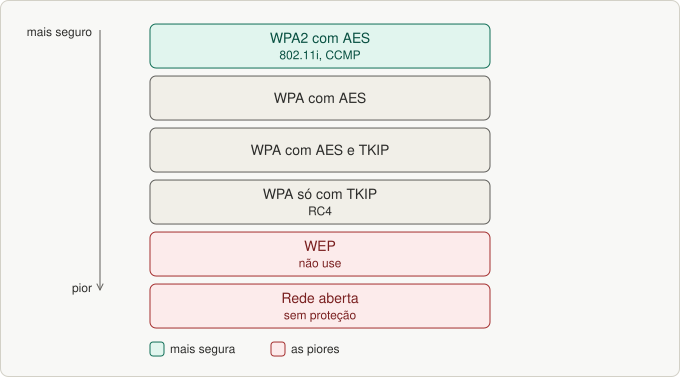
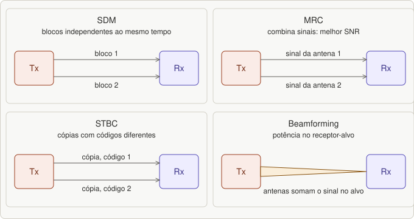
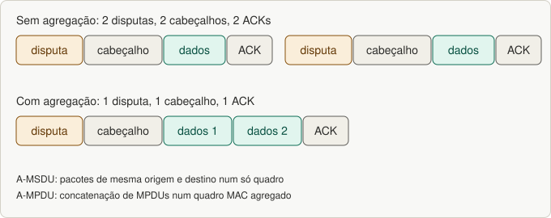

# Aula 11 — Segurança Wi-Fi e evolução do 802.11

> Base: *Wi-Fi · aula 9 (segurança e extensões)*. Lista: [`listas/lista-11.md`](../listas/lista-11.md)

## 1. Por que as redes sem fio são mais inseguras

- As informações podem ser **copiadas por receptores colocados sem permissão**.
- Serviços podem ser retirados (***denial of service***) por estações que **entram na rede sem permissão**.
- Diferente das redes físicas, os ataques podem vir de **quem não tem acesso a uma porta de hub ou switch** (o ar é aberto).
- Há **falta de segurança centralizada**.

Dois objetivos: **controle de acesso** (só usuários autorizados acessam dados sensíveis) e **privacidade** (só a audiência determinada recebe e interpreta os dados).

### Os padrões de segurança

| Padrão | O que é |
|---|---|
| **WEP** (*Wired Equivalent Privacy*) | o **primeiro**; objetivo: tornar o Wi-Fi **tão seguro quanto uma Ethernet** (e, como o padrão da Ethernet é nenhuma segurança, "é fácil alcançar"). **Criptografia** por **chave secreta** (a mesma cifra e decifra) + algoritmo de **integridade**. **Autenticação**: *Open System* ou *Shared Key*. **Não é padrão desde 2004** (Wi-Fi Alliance); **não use** |
| **WPA** | **medida emergencial** até o 802.11i, **sem trocar o hardware**. **TKIP**: a chave é **trocada periodicamente** (a *passphrase* só faz a conexão inicial); usa **RC4**. Autenticação por **802.1X/EAP** |
| **WPA2 (802.11i)** | padrão definitivo; **AES** (chaves de 128 a 256 bits) e **CCMP**; exige **mais processamento** (problema para APs baratos) |

No **802.1X/EAP**, os quadros EAP são tratados como **dados de camada superior**: a estação só envia dados pelo AP no estado **"autenticado e associado"**; primeiro autentica e associa ao AP (quadros de gerenciamento, com *Open System*) e **só depois** faz a autenticação de rede.

Ordem de opções (da mais segura à pior): **WPA2 com AES → WPA com AES → WPA com AES e TKIP → WPA só com TKIP → WEP → rede aberta**.

*Figura 26.1: Opções de segurança Wi-Fi, da mais segura à pior.*

## 2. Evolução do 802.11 (as extensões)

| Padrão | O que traz |
|---|---|
| **802.11a** | maior taxa; **5 GHz** (menos interferência); fim de 1999 |
| **802.11b** | **HR-DSSS**, **2,4 GHz**, 5,5 e 11 Mbps; fim de 1999; foi a mais usada |
| 802.11c | complementa o 802.1d (bridging) para APs |
| 802.11d | acesso WLAN **global** (requisitos de canalização e saltos para outros países) |
| **802.11e** | **QoS**: classes de serviço, melhorias no DCF e no PCF, melhor áudio e vídeo |
| 802.11f | **IAPP**: interoperabilidade de APs de fabricantes diferentes no **roaming** |
| **802.11g** | até **54 Mbps** em **2,4 GHz**, **OFDM**, compatível com o 11b; cobertura menor que o 11b a 11 Mbps |
| 802.11h | seleção de canal **indoor/outdoor** em 5 GHz (Europa); seleção dinâmica de canal |
| **802.11i** | **segurança** (802.1X + AES) |
| 802.11j | operação nas bandas **4,9 e 5 GHz** no Japão |
| 802.11k | medidas de rádio para níveis altos (apoia roaming) |
| 802.11m | manutenção/correções do padrão |
| **802.11n** | **2,4 e 5 GHz**, MIMO, até **600 Mbps** (veja abaixo) |
| 802.11p | redes **veiculares** (WAVE) |
| 802.11r | **hand-off rápido** ao mudar de AP |
| 802.11s | redes **mesh** (*self-healing, self-configuring*) |
| 802.11t | métodos de **medida de desempenho** |
| 802.11v | **gerência** de clientes (paradigmas parecidos com os de redes celulares) |
| 802.11w | mais **segurança** nos quadros de gerenciamento |
| 802.11x | **não usado** (confusão com 802.1x) |
| 802.11z | operação em **3.650–3.700 MHz** só nos EUA |
| **802.11ac** | sucessor do n; **5 GHz**, **256-QAM**, canais de **80 MHz** (160 opcional), até **8 spatial streams**, **MU-MIMO**; mais de 6 Gbps |
| 802.11ad | **WiGig**, **60 GHz**, multi-gigabit, WPAN |
| 802.11af | **WhiteFi**: usa **espaços brancos da TV** |
| 802.11ah | **HaLow**: IoT, **900 MHz**, baixo consumo |

## 3. O 802.11n em detalhe

- **2,4 e 5 GHz**; canais de **20 MHz, 40 MHz** ou conversão automática 40/20. Em 2,4 GHz até **288,9 Mbps**; em 5 GHz, canal de 40 MHz permite **600 Mbps**.
- **Intervalo de guarda** reduzido de **800 ns para 400 ns** (negociado, quando a diferença máxima de tempos de propagação é menor, ~120 m).
- Mais subportadoras OFDM: **56 em 20 MHz** e até **114 em 40 MHz**; **64-QAM**.
- **RIFS** (*Reduced IFS*) de **2 µs**, no lugar do SIFS de 16 µs.

### MIMO (pergunta da lista)

**MIMO** (*Multiple-Input Multiple-Output*) usa **várias antenas** no transmissor e no receptor. O receptor precisa estimar as características dos canais; isso é feito transmitindo **sequências conhecidas**, com as quais o sistema "aprende" a avaliar os símbolos de cada antena. Técnicas:

| Técnica | O que faz |
|---|---|
| **SDM** (*Spatial Division Multiplexing*) | divide o fluxo em **blocos independentes**, enviados por **antenas diferentes ao mesmo tempo** (mais **vazão**) |
| **MRC** (*Maximum Ratio Combining*) | **combina os sinais** de várias antenas para **otimizar a SNR** |
| **STBC** (*Space-Time Block Coding*) | gera **códigos diferentes** para enviar **cópias** do fluxo por antenas diferentes (mais **confiabilidade**) |
| **Beamforming** | os sinais das várias antenas **maximizam a potência no receptor-alvo** |

*Figura 26.2: As quatro técnicas do MIMO.*

**Por que se usa?** Para **aumentar a taxa, a confiabilidade e o alcance** aproveitando o multipercurso.

### Agregação de quadros (A-MSDU, pergunta da lista)

Reduz o **número de eventos de contenção**, porque várias unidades de dados vão **num só quadro**, com **um só cabeçalho, uma disputa e um ACK**:

- **A-MSDU:** pacotes de **mesma origem e destino**.
- **A-MPDU:** **concatenação de MPDUs** num quadro MAC agregado.

*Figura 26.3: Agregação de quadros reduz disputas, cabeçalhos e ACKs.*

## 4. O 802.11ac em detalhe

- Até **8 spatial streams**; **433 Mbps** no modo mais simples; **1,3 Gbps com 3 antenas**; **mais de 6 Gbps** na configuração máxima. Dispositivos de usuário dificilmente terão 8 antenas, então a solução é **downlinks simultâneos** a partir dos APs.
- **256-QAM** (mais sensível a ruído, exige **sinal mais potente**), **5 GHz**, canais de **80 MHz** (160 opcional).
- **MU-MIMO:** vários usuários transmitem/recebem **simultaneamente**. **Beamforming padronizado** (opcional no 11n). **Uplinks dos APs devem ser de Gbit**.

---

## Exercícios

Lista: [`listas/lista-11.md`](../listas/lista-11.md) — respostas: [`respostas/lista-11.md`](../respostas/lista-11.md)

---

## Resumo

- Wi-Fi é mais inseguro: **ar aberto**, cópia de dados, DoS, **sem segurança centralizada**.
- **WEP** (RC4, quebrado) → **WPA** (TKIP) → **WPA2/802.11i** (AES + CCMP).
- Evolução: **a** (5 GHz, OFDM), **b** (HR-DSSS, 11 Mbps), **g** (OFDM em 2,4 GHz), **n** (MIMO, 600 Mbps), **ac** (256-QAM, MU-MIMO), mais **e** (QoS), **i** (segurança), **r**, **s**, **ad/af/ah**.
- **MIMO:** SDM, MRC, STBC, beamforming. **A-MSDU/A-MPDU** reduzem a contenção.
