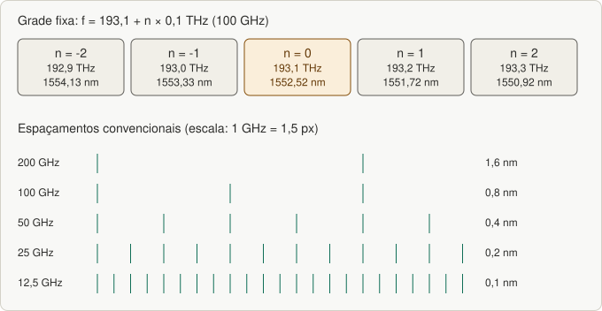
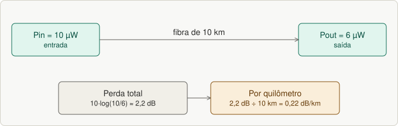
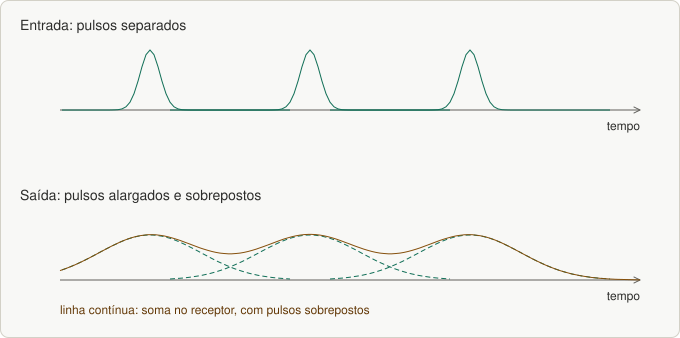

# Aula 15 — DWDM: bandas, fibras, canais, atenuação e dispersão

> Base: *aula 13 – DWDM* (primeira parte). Lista: [`listas/lista-15.md`](../listas/lista-15.md)

## 1. O que é DWDM

**DWDM** (*Dense Wavelength Division Multiplexing*) **combina dezenas de canais numa só fibra**, economizando fibras e otimizando a transmissão (número de canais × banda final). É **padronizado pelas normas ITU G.694.1 e ITU-T G.671** e estendido em padrões proprietários.

Analogia: uma **rodovia de várias faixas**, onde cada faixa é uma "cor" (comprimento de onda) de luz; todas passam pela mesma fibra sem se misturar.

## 2. Bandas

Os sistemas de comunicação óptica operam entre **800 e 1600 nm**, no **infravermelho** (invisível). A **ITU definiu seis bandas**; as **mais usadas comercialmente são as bandas O e C**. *(Complemento: O ≈ 1260–1360 nm, E, S, **C ≈ 1530–1565 nm**, L, U.)*

## 3. Fibras monomodo

| Fibra | Característica | Norma |
|---|---|---|
| **SMF** (*Standard Single Mode*) | **dispersão zero em 1310 nm** | ITU-T **G.652** |
| **DSF** (*Dispersion-Shifted*) | curva deslocada para ter **dispersão zero em 1550 nm**; sistemas com um λ em 1550 nm | ITU-T **G.653** |
| **NZDSF** (*Non-Zero DSF*) | **pequena dispersão** na janela de 1550 nm para evitar o **Four Wave Mixing** (principal efeito não linear); **DWDM de longo alcance e altas taxas** | ITU-T **G.655** |
| **Zero Water Peak** | elimina o **pico de água (OH)**, abrindo **toda a janela de 1300 a 1600 nm**; ideal para **CWDM metropolitano** | ITU-T **G.652C** |

## 4. Canais e grade

**Espaçamento convencional entre canais:** **200 GHz (1,6 nm)**, **100 GHz (0,8 nm)**, **50 GHz (0,4 nm)**, **25 GHz (0,2 nm)**, até **12,5 GHz (0,1 nm)**. Quanto menor o espaçamento, **mais canais cabem** na fibra. **CWDM × DWDM:** o CWDM usa espaçamento **bem maior** e poucos canais; o DWDM é **denso**. *(Complemento: CWDM ≈ 20 nm.)*

### Grade fixa (frequências centrais nominais, em THz)

**f = 193,1 + n × passo**, com *n* inteiro e passo de **0,0125** (12,5 GHz), **0,025** (25 GHz), **0,05** (50 GHz) ou **0,1** (100 GHz).

Para converter em comprimento de onda: **λ = c / f**. Exemplo: n = 0 → 193,1 THz → ~**1552,52 nm**.


*Figura 30.1: Grade DWDM e espaçamentos entre canais.*

### Grade flexível (*flexible DWDM grid*)

- Canais com **larguras diferentes**; permite combinar **modulações e taxas diferentes** num mesmo sistema.
- Dificulta a **interoperabilidade**, por isso **só aparece em padrões proprietários**, não em recomendações de interface.
- Frequência central: **193,1 + n × 0,00625 THz** (granularidade de 6,25 GHz); largura do slot: **12,5 × m GHz** (*m* inteiro positivo). Qualquer combinação é permitida, **desde que os slots não se sobreponham**.

## 5. Atenuação

**Principais causas:** **absorção**, **espalhamento**, **irradiação por curvaturas**, **perdas por microcurvaturas**, **atenuação em emendas e conexões** e **perdas por acoplamento**.

| Causa | Detalhe |
|---|---|
| **Absorção** (principal) | **intrínseca** (absorção parcial de luz ao atravessar o meio), **extrínseca** (**impurezas** da fabricação) e **por efeitos estruturais** (imperfeições, como falta de moléculas ou defeitos de oxigênio no vidro). **WPA** (*Water Peak Attenuation*): contaminação por **íons hidroxila (OH⁻)** |
| **Espalhamento** | desvio de parte da energia guiada; causado por **flutuações térmicas, variações de pressão, pequenas bolhas** e variações no perfil do índice de refração; o principal é o **espalhamento de Rayleigh** (variações aleatórias de densidade da fibra, da fabricação) |
| **Curvaturas** | **macroscópicas** (raios grandes comparados ao diâmetro da fibra) e **microscópicas** (curvaturas aleatórias do eixo, com raios próximos ao do núcleo; ocorrem nos cabos) |
| **Construtivos e de instalação** | emendas e conexões: **diferença de diâmetro**, **de perfil de índice**, **desalinhamento axial e angular**, **deslocamento longitudinal**, **rugosidade nas pontas** e **sujeira nos conectores** |

### Cálculo
**Perda (dB) = 10·log₁₀(Pin/Pout)**; por km: divide-se pelo comprimento. Exemplo do slide: fibra de 10 km, Pin = 10 µW, Pout = 6 µW → **10·log(10/6) = 2,2 dB → 0,22 dB/km**.


*Figura 30.2: Atenuação do exemplo: 2,2 dB em 10 km.*

## 6. Dispersão

**Dispersão** vem dos **diferentes tempos de chegada** ao receptor de cada componente que se propaga; causa **alargamento temporal do sinal** e **limita a banda passante** e a **taxa de transmissão**.


*Figura 30.3: Dispersão: o alargamento dos pulsos causa sobreposição.*

| Tipo | Causa |
|---|---|
| **Modal** | só em **multimodo** (degrau e gradual): **vários caminhos** da luz no núcleo |
| **Material** | cada comprimento de onda "vê" um **índice de refração diferente**; deve-se à **largura espectral finita** das fontes |
| **De guia de onda** | variações nas **dimensões do núcleo** e no perfil de índice; depende do comprimento de onda |
| **PMD** (modo de polarização) | a energia se divide em **dois modos de polarização ortogonais** com velocidades levemente diferentes |
| **Cromática** | componentes de frequência diferentes viajam em **velocidades diferentes** → **distorção** e **interferência intersimbólica**, "**fechamento do olho**"; pode ser **compensada** |

**Como minimizar a dispersão cromática:** ela **geralmente não é problema abaixo de 10 Gbps**; usar **lasers de espectro estreito**; **novos tipos de fibra (NZ-DSF)**; **técnicas de compensação**, como os **módulos compensadores de dispersão (DCM)**, colocados em estágios intermediários e no acesso do EDFA.

## 7. Pratique

```bash
cd praticas
node dwdm_grade.js 100      # frequências e λ da grade de 100 GHz e nº de canais na banda C
node enlace_optico.js 10 6 10   # atenuação do exemplo do slide
```

---

## Exercícios

Lista: [`listas/lista-15.md`](../listas/lista-15.md) — respostas: [`respostas/lista-15.md`](../respostas/lista-15.md)

---

## Resumo

- **DWDM:** muitos canais numa fibra; ITU G.694.1 e G.671; bandas **O** e **C** são as mais usadas.
- Fibras: **G.652** (SMF), **G.653** (DSF), **G.655** (NZDSF), **G.652C** (zero water peak).
- Grade: **f = 193,1 + n·passo (THz)**; espaçamentos 200/100/50/25/12,5 GHz; **grade flexível** (6,25 GHz, slot 12,5·m GHz).
- Atenuação: **absorção, espalhamento (Rayleigh), curvaturas, emendas/conexões**; **dB = 10 log(Pin/Pout)**.
- Dispersão: **modal, material, guia de onda, PMD, cromática**; compensação por **DCM** e **NZ-DSF**.
