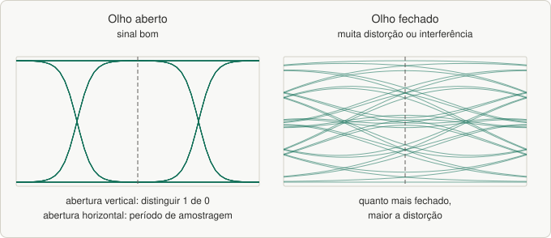
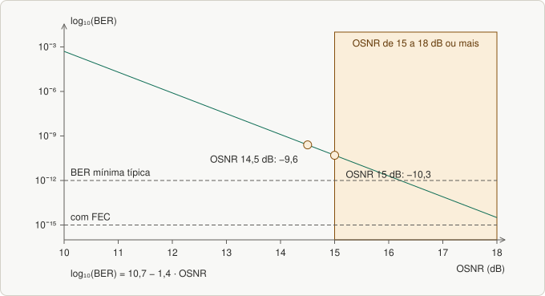
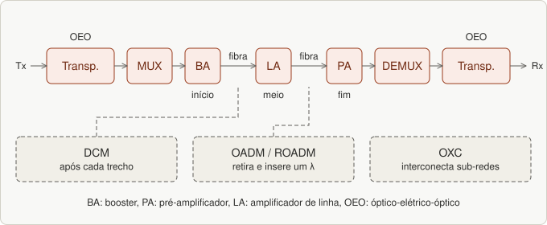

# Aula 16 — DWDM: BER, diagrama do olho, OSNR e arquitetura do sistema

> Base: *aula 13 – DWDM* (segunda parte). Lista: [`listas/lista-16.md`](../listas/lista-16.md)

## 1. BER — Bit Error Rate

**BER** é um dos **parâmetros-chave** do projeto de um sistema óptico: **número de bits errados recebidos ÷ total de bits transmitidos** num período. O objetivo é ir do Tx ao Rx com **BER menor que o limite do Rx**. O BER mínimo aceitável típico é **10⁻¹²** (**10⁻¹⁵ com FEC**).

**Causas:** **ruído** de receptores e amplificadores; **distorção do pulso** por dispersão e efeitos não lineares. Elas dificultam decidir se um bit é 1 ou 0.

## 2. Diagrama do olho

Observado num **osciloscópio**: amostras pseudoaleatórias coletadas por um receptor óptico; o sinal é plotado na **vertical** e a **taxa de sinalização** varre a **horizontal**, formando um desenho parecido com um **olho**.

- **Abertura vertical:** capacidade de **distinguir um bit 1 de um 0**.
- **Abertura horizontal:** **período em que o sinal pode ser amostrado**.
- **Quanto mais fechado o olho, maior a distorção** por ruído e/ou interferência intersimbólica.


*Figura 31.1: Diagrama do olho aberto e fechado.*

## 3. Fator de qualidade Q

Representa a **qualidade do sinal no domínio óptico, antes do FEC**, medido pelo diagrama do olho a partir dos **desvios padrão** do bit 1 (σ₁) e do bit 0 (σ₀).

## 4. OSNR — Optical Signal to Noise Ratio

- Diferença entre a **energia do sinal** e a **do ruído**, em **dB**, medida **no receptor**; outro parâmetro-chave do desempenho.
- Pode ser vista como o **QoS da camada física**. Está **diretamente relacionada à BER**, o que leva a **perdas de pacotes** nas camadas superiores. Depende do **número de amplificadores**, do **alcance** e dos **formatos de modulação**.
- Pode ser afetada por **redução da potência**, **dispersão**, **polarização** e **amplificação desbalanceada**.
- Fórmula do slide: depende de **Psig** (potência do canal *i*), **N** (ruído na largura de banda do canal), **Br** (banda de referência, geralmente 0,1 nm) e **Bm** (banda do ruído). O **OSNR no receptor deve ficar acima de 15 a 18 dB** (varia com taxa e BER exigido).

### Da OSNR para a BER
Fórmula empírica (fibra única): **log₁₀(BER) = 10,7 − 1,4 · OSNR**.

> **Atenção ao slide:** o exemplo escreve OSNR = 14,5 dB e log(BER) = **−10,30**, mas **10,7 − 1,4 × 14,5 = −9,60** (BER ≈ 10⁻⁹·⁶). O valor −10,30 sai com **OSNR = 15 dB**. Nos dois casos o BER é da **ordem de 10⁻¹⁰**, que é a conclusão do slide.


*Figura 31.2: Relação entre OSNR e BER pela fórmula da aula.*

## 5. Arquitetura de um sistema DWDM

Elementos típicos: **Mux/Demux**, **OADM/ROADM**, **OXC**, **amplificadores (BA/LA/PA)**, **DCM**, **transponders**, **atenuadores**.

```
 Tx ─► Transponder ─► [MUX] ─► BA ═══ fibra ═══ LA ═══ fibra ═══ PA ─► [DEMUX] ─► Transponder ─► Rx
                                     (DCM entre os trechos)         (OADM/ROADM no meio, OXC nas interconexões)
```


*Figura 31.3: Arquitetura de um sistema DWDM.*

| Elemento | Função |
|---|---|
| **Mux / Demux** | o **multiplexador converge** sinais de vários comprimentos de onda **num único feixe**; o **demultiplexador faz o inverso** (em direções opostas do enlace) |
| **OADM / ROADM** | **retira um sinal e insere um novo de mesmo comprimento de onda**, deixando passar os demais |
| **OXC** | permite a **interconexão de sub-redes** |
| **Amplificador Booster (BA)** | **começo do enlace**; **alta potência de saída e baixa sensibilidade de recepção** |
| **Amplificador de Linha (LA)** | **meio do enlace**; potência de saída e sensibilidade **moderadas** |
| **Pré-amplificador (PA)** | **fim do enlace**; **baixa potência de saída e alta sensibilidade de recepção** |
| **DCM** | fibras com **dispersão cromática oposta** (ou inclinação adequada) para levar a **dispersão média do enlace perto de zero**; a fibra de compensação pode ter **vários km** e o DCM costuma ser inserido **após cada trecho** |
| **Transponder** | converte o sinal óptico do cliente em **λ adequado ao DWDM**; é um conversor **óptico-elétrico-óptico (OEO)**: converte o sinal para elétrico, **regenera** e emite de novo |
| **Transmissores e receptores ópticos** | fornecem os sinais de origem; exigem **comprimentos de onda muito precisos** (sem distorção interchannel ou *crosstalk*); **vários lasers**, cada um em um λ |
| **Atenuador (VOA)** | atenuador óptico variável: usado em **teste e medição** e, no **EDFA**, para **equalizar a potência** entre canais |

*(Complemento)* **Sinal cinza × colorido:** cinza = sinal do cliente num λ padrão; colorido = λ da **grade ITU**, gerado pelo **transponder**. Multiplexar canais de várias cores é exatamente o WDM.

## 6. Pratique

```bash
cd praticas
node enlace_optico.js 10 6 10 14.5     # atenuação e BER a partir da OSNR
```

---

## Exercícios

Lista: [`listas/lista-16.md`](../listas/lista-16.md) — respostas: [`respostas/lista-16.md`](../respostas/lista-16.md)

---

## Resumo

- **BER** meta: **10⁻¹²** (10⁻¹⁵ com FEC). **Olho** aberto = sinal bom.
- **OSNR** > 15–18 dB no receptor; relação com BER: **log BER = 10,7 − 1,4·OSNR**.
- Arquitetura: **Mux/Demux, OADM/ROADM, OXC, BA/LA/PA, DCM, transponders (OEO), atenuadores (VOA)**.
- **BA** = saída alta (início); **LA** = meio; **PA** = sensibilidade alta (fim).
